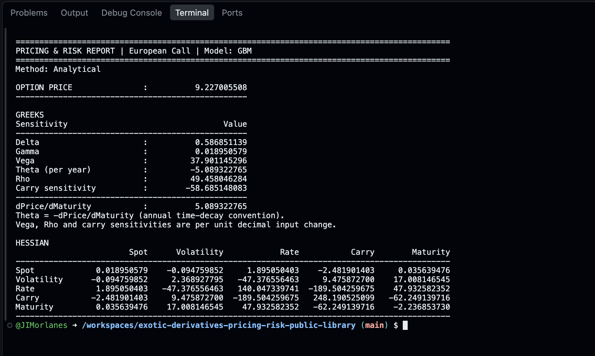
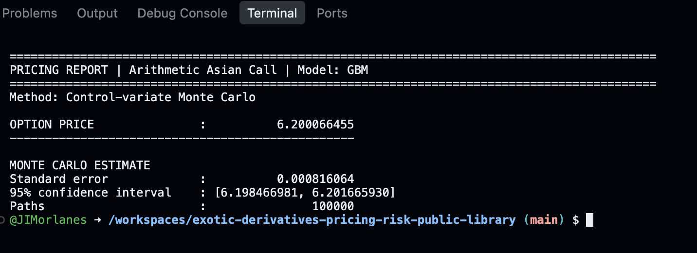

# C++23 Exotic Derivatives Pricing & Risk Library

A multiparadigm C++23 numerical library combining a polymorphic API, type-safe runtime dispatch and a template-based numerical core. API contracts, product definitions and numerical policies are kept separate, so the architecture can be extended to additional products and pricing models.

- **Dynamic polymorphism at the API boundary**: a common `PricingEngine` interface separates callers from concrete engine implementations.
- **Type-safe product dispatch**: `std::variant`, `std::visit` and `if constexpr` connect runtime product selection to compiled pricing branches.
- **Static polymorphism in numerical components**: model, random-number generator and statistics policies are bound at compile time, exposing concrete types for compiler specialisation and inlining.
- **Parallel risk calculation**: Boost.Asio distributes bumped repricings to compute a five-factor gradient and full 5×5 Hessian, with common random numbers to reduce noise in Monte Carlo sensitivity estimates.
- **Streaming numerical statistics**: online moments and covariance accumulation keep working memory independent of the simulated path count for a fixed observation schedule.

The implementation covers European, Asian and continuously monitored barrier options under GBM, with analytical and Monte Carlo pricing, variance reduction and documented numerical checks.

In the documented 100,000-path arithmetic-Asian example, the geometric control variate reduced reported standard error by **35.10×**. For continuous zero-rebate barriers under GBM, Brownian-bridge survival weighting removes the monitoring bias from checking crossings only at simulated endpoints.

This repository contains the compiled Linux CLI, architecture documentation with UML diagrams and the numerical validation report. The C++ source and tests remain private.

## Run in GitHub Codespaces

[](https://codespaces.new/JIMorlanes/exotic-derivatives-pricing-risk-public-library?quickstart=1)

1. Click the button above. A GitHub account is required; usage counts towards
   your Codespaces allowance.
2. Wait for the container setup to finish. Setup took about **35 seconds** in
   an observed run; timing can vary. The demo runs the prebuilt CLI, so no
   compilation is required.
3. VS Code opens in your browser. Use the terminal at the bottom of the window.
   If it is not visible, select **Terminal → New Terminal**.
4. Paste this command to price a European call and compute its Greeks and full 5×5 Hessian:

   ```sh
   pricing_cli risk --type call --spot 100 --strike 100 --maturity 1 \
     --volatility 0.20 --rate 0.05 --carry 0.02 --threads 4
   ```

5. Then try Monte Carlo pricing with uncertainty reporting, as shown below, or run
   `pricing_cli --help` for all commands.

The executable is Linux x86-64 only. Codespaces supplies the compatible Linux
environment, so no local installation is needed. The container adds `bin/` to
`PATH` and installs the required Linux runtime libraries.

If you created a Codespace before this configuration was added, rebuild its
container.

## CLI demonstration

### Price, Greeks and full Hessian

Running the command from step 4 in the Codespace produces:



```text
PRICING & RISK REPORT | European Call | Model: GBM
Method: Analytical

OPTION PRICE               :          9.227005508

GREEKS
Delta                      :          0.586851139
Gamma                      :          0.018950579
Vega                       :         37.901145296
Theta (per year)           :         -5.089322765
Rho                        :         49.458046284
Carry sensitivity          :        -58.685148083

dPrice/dMaturity           :          5.089322765
Theta = -dPrice/dMaturity (annual time-decay convention).
Vega, Rho and carry sensitivities are per unit decimal input change.

HESSIAN            Spot     Volatility           Rate          Carry       Maturity
Spot        0.018950579   -0.094759852    1.895050403   -2.481901403    0.035639476
Volatility -0.094759852    2.368927795  -47.376556463    9.475872700   17.008146545
Rate        1.895050403  -47.376556463  140.047339741 -189.504259675   47.932582352
Carry      -2.481901403    9.475872700 -189.504259675  248.190525099  -62.249139716
Maturity    0.035639476   17.008146545   47.932582352  -62.249139716   -2.236853730
```

### Monte Carlo with a control variate

Arithmetic Asian call with a geometric Asian control variate (four quarterly fixings, 100,000 paths and seed 42):

```sh
pricing_cli price --type call --spot 100 --strike 100 --maturity 1 \
  --volatility 0.20 --rate 0.05 --carry 0.02 --product asian --average arithmetic --steps 4 \
  --method cv --paths 100000 --seed 42
```



```text
PRICING REPORT | Arithmetic Asian Call | Model: GBM
Method: Control-variate Monte Carlo

OPTION PRICE               :          6.200066455

MONTE CARLO ESTIMATE
Standard error             :          0.000816064
95% confidence interval    : [6.198466981, 6.201665930]
Paths                      :               100000
```

## Pricing and risk capabilities

All products support calls and puts.

| Product | Analytical pricing | Monte Carlo methods |
|---|---|---|
| European | Black–Scholes | Plain MC; antithetic variates |
| Geometric Asian | Discrete geometric-average formula | Plain MC |
| Arithmetic Asian | — | Plain MC; geometric Asian control variate |
| Up/down, in/out barriers | — | Conditional Brownian-bridge survival weighting |

- **Continuous barriers:** zero-rebate valuation accounts for crossings between
  simulated endpoints through conditional survival weights.
- **Risk:** Boost.Asio parallel repricing produces a five-factor gradient and
  full 5×5 Hessian in spot, volatility, rate, carry and maturity. Reports include
  Delta, Gamma, Vega, Rho, carry sensitivity and annual Theta.
- **Monte Carlo uncertainty:** option-price standard error, nominal 95%
  confidence interval and path count; common random numbers for bumped risk.
- **Implied volatility:** European Black–Scholes inversion using
  `--solver toms748|bisection|newton`; TOMS 748 is the default.
- **CLI:** `price`, `risk`, `iv` and `--help`, with input validation and explicit
  errors for unsupported combinations.

## Measured numerical results

Recorded in GitHub Codespaces (Linux x86-64) on 2026-10-30; calls,
100,000 paths, seed 42. Base market:
S=K=100, T=1 year, volatility=20%, r=5%, q=2%; Asian fixings at
0.25, 0.50, 0.75 and 1.00 years. The barrier reference case instead uses K=120,
q=0, barrier=80 and 52 bridge intervals.

| Case | Analytical/reference | MC estimate | Standard error |
| --- | --- | --- | --- |
| European: plain MC | 9.227005508 | 9.288828450 | 0.044039111 |
| European: antithetic MC | 9.227005508 | 9.229877274 | 0.032511041 |
| Geometric Asian: MC | 6.016110665 | 6.043182219 | 0.027959723 |
| Arithmetic Asian: MC | — | 6.227787630 | 0.028642284 |
| Arithmetic Asian: control variate | — | 6.200066455 | 0.000816064 |
| Down-and-out barrier: MC | 3.240720355 | 3.206151383 | 0.027315764 |

For the arithmetic Asian call, the control variate gave **35.10× lower
reported standard error** than plain MC at the same path count. This measures
sampling uncertainty, not runtime speedup. No analytical arithmetic-Asian price
is claimed.

The [numerical validation report](docs/numerical_validation.md) focuses on four
representative comparisons: analytical European calls/puts, arithmetic Asian
MC versus control variate, a published continuous-barrier benchmark and
analytical Greeks with selected mixed Hessian entries. Parameters, errors,
uncertainty and reproduction commands accompany the results.
**Original private validation: all 10 registered CTest tests passed locally.**

## C++23 engineering design

**Language standard:** the project targets C++23. It uses C++20
`std::span` for non-owning observation-schedule views and `std::latch` to
synchronise parallel risk batches, alongside C++17 `std::variant`,
`std::visit` and `if constexpr`.

The following describes the private implementation behind the executables.

```text
CLI → PricingRequest → GBMPricingEngine → numerical pricers → PricingResult
```

- **Dynamic polymorphism at the API boundary:** the virtual `PricingEngine`
  contract lets API callers depend on a common engine interface.
  `GBMPricingEngine` validates and dispatches supported product/method combinations.
- **Type-safe runtime product selection:** `std::variant` stores product/model
  alternatives; `std::visit` selects the product at runtime and `if constexpr`
  chooses its compiled branch.
- **Static polymorphism in numerical components:** the model, RNG and statistics
  policies of `MonteCarloPricer<Model, RNG, Statistics>` are bound at compile time,
  exposing concrete types for compiler specialisation and inlining.
  `PathGenerator<Model, RNG>` follows the same model/RNG policy design; references
  are non-owning.
- Products own their fixing/monitoring schedules. Market inputs and pricing
  results remain separate value types.
- `RiskEngine::calculate` accepts a pricing callable and owns a Boost.Asio worker
  pool. The CLI retains the base pricing statistics and constructs local RNGs
  for bumped calculations using a common seed.

UML diagrams (PNG):

1. [Pricing architecture](./docs/uml/01_pricing_architecture.png)
2. [Pricing, simulation and policies](./docs/uml/02_pricing_simulation_policies.png)
3. [Monte Carlo execution](./docs/uml/03_monte_carlo_execution.png)
4. [Implied volatility and solvers](./docs/uml/04_implied_volatility_solvers.png)
5. [Finite-difference risk and Hessian](./docs/uml/05_risk_numerics_detail.png)

## CLI command examples

Run these commands in the Codespace terminal.

```sh
# Analytical European call
pricing_cli price --type call --spot 100 --strike 100 --maturity 1 \
  --volatility 0.20 --rate 0.05 --carry 0.02

# Price, Greeks and full Hessian
pricing_cli risk --type call --spot 100 --strike 100 --maturity 1 \
  --volatility 0.20 --rate 0.05 --carry 0.02 --threads 4

# Select any of the three IV solvers; --method is reserved for pricing
pricing_cli iv --type call --spot 100 --strike 100 --maturity 1 \
  --rate 0.05 --carry 0.02 --market-price 9.227005508154036 --solver newton

pricing_cli --help
```

Rates and volatility are decimals; maturity and observation times are years.
MC requires `--paths` and `--seed`. Asian/barrier grids use exactly one of
`--steps N` or `--times t1,t2,...`. Detailed examples are in the validation report.
Fitted Asian CV needs at least three paths. A single-fixing CV uses an exact
control identity and accepts two paths; all requested paths are still simulated.

## Numerical methods and limitations

GBM paths use the exact lognormal transition without Euler discretisation,
avoiding the associated time-discretisation bias. Monte Carlo pricing uses a
streaming design to limit memory use: Welford's algorithm updates mean and sample
variance in one pass with centred updates that reduce cancellation, while
control-variate covariance is accumulated online. Asian and barrier pricing
retain running payoff aggregates instead of complete paths or payoff samples.
For a fixed observation schedule, working memory per pricing call does not grow
with the number of simulated paths.

Continuous zero-rebate barriers use conditional Brownian-bridge survival weights
to account for crossings between simulated endpoints. To reduce sampling
uncertainty, European antithetic MC pairs opposite normal draws, while arithmetic
Asian control variates use the correlated geometric payoff with its analytical
mean. Antithetic errors are estimated from pair averages.

Risk uses central finite differences so the same pricing callable supplies
first- and second-order sensitivities. Boost.Asio distributes the separate bumped
repricings across worker threads to compute the five-factor gradient and full
symmetric Hessian. For Monte Carlo, common seeds help reduce sampling noise in
the price differences; Theta is `-dPrice/dMaturity`.

Scope is constant-parameter GBM, European/Asian payoffs and continuous zero-rebate
barriers. Heston pricing, zero-volatility/expiry limiting formulas and general
rebates are unsupported. Spot, strike, volatility and maturity must be positive;
finite negative rates/carry are accepted.

Plain/antithetic MC intervals use a normal approximation. Fitted CV uses an
approximate regression interval with residual degrees of freedom and a Student-t
multiplier; three samples is a minimum, not a reliable-inference recommendation.
Greek/Hessian uncertainty is not estimated, and nonsmooth payoffs remain
sensitive to bumps and sample size.
Seeded streams are reproducible within the same standard-library environment.
TOMS 748 and Bisection are bracketed; Newton uses analytical Vega and may fail
when an iterate leaves the admissible interval or Vega is too small. There is
no automatic fallback. `--max-evaluations` counts function evaluations for
TOMS 748 and iterations for Bisection/Newton.

## Detailed documentation

- [Numerical validation and reproducible experiments](docs/numerical_validation.md)
- [Architecture, four UML class views and execution sequences](docs/architecture.md)
