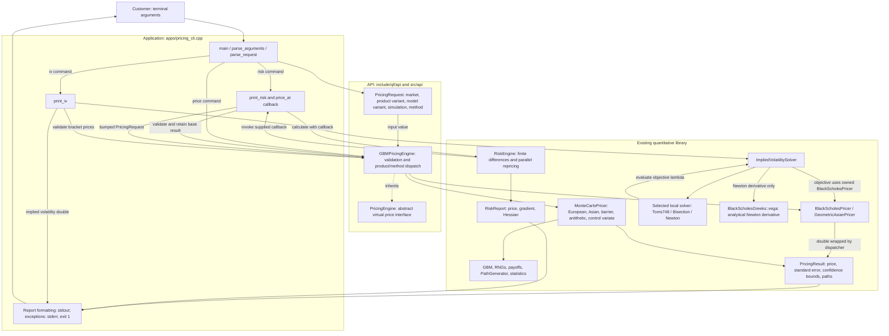
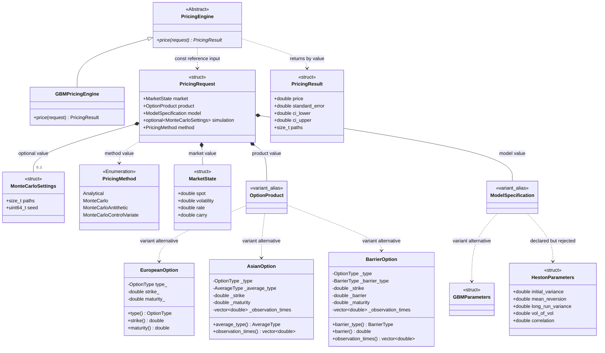
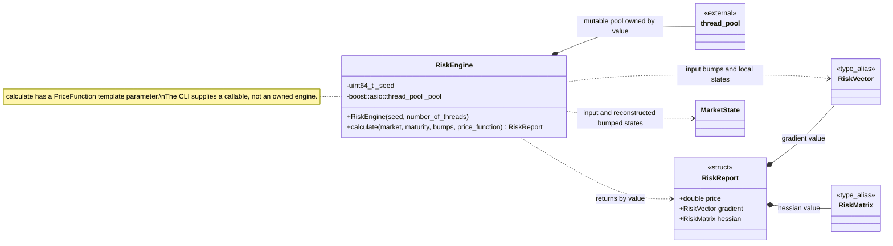
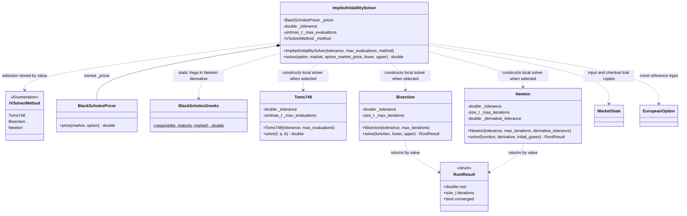
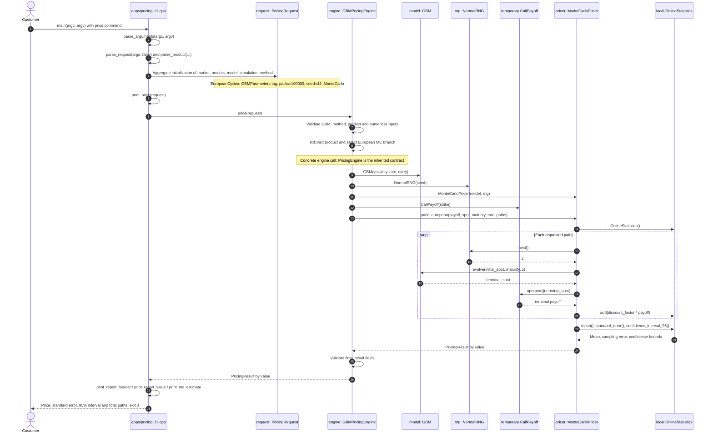
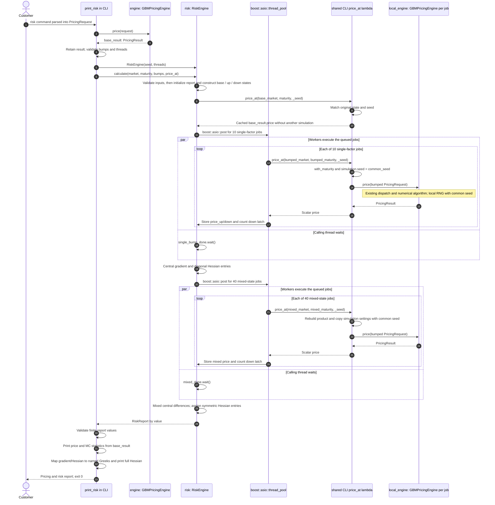
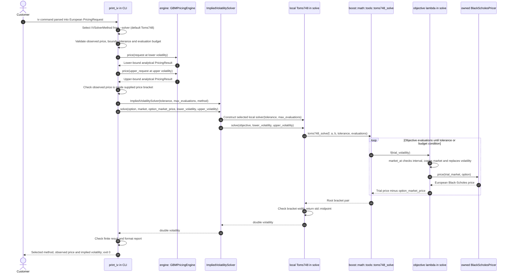

# Architecture and UML: Exotic Derivatives Pricing & Risk Library

Public documentation of the private implementation. Source and test references
identify the original project; those files are not distributed in this package.
The five PNG views are available in [uml/](uml/).

This document describes the implemented C++23 project. The source files, headers,
CMake targets, examples and tests were inspected directly. It documents the
current application, including reuse of the base `PricingResult` in risk reports.

Class views: [API and products](#21-request-domain-values-and-engine-contract),
[pricing and simulation](#22-pricing-simulation-and-policy-types),
[risk](#23-risk-engine-and-result-structures), and
[IV solvers](#24-implied-volatility-and-numerical-solvers).

## Reading the diagrams

- Component boxes represent modules, data values or functions, not additional
  implementation classes. The CLI is a translation unit containing free functions.
- In class diagrams, `*--` means owned value/subobject, `-->` means a non-owning
  association, `..>` means a use/creation dependency and `<|--` means inheritance.
  The `*` operation marker means abstract; `$` marks a static operation. These
  markers describe UML operations, not C++ pointer or ownership types.
- `<<template>>` marks a real class template. Its parameter list appears in a
  note; policy-binding labels identify the concrete arguments used by the
  dispatcher. These bindings are not inheritance relationships.
- Nodes marked `variant_alias` or `type_alias` represent existing C++ `using`
  declarations. They are not new classes. Variant alternatives are mutually
  exclusive; an object does not contain all alternatives simultaneously.
- Class identifiers are unqualified for readability; their source paths and
  namespaces are identified below. Operation parameter lists in diagrams are
  abbreviated. Exact C++ declarations remain private; diagram signatures are abbreviated.
- Sequence lifelines denote actual objects, free functions, lambdas or external
  library functions. The risk callback is one shared CLI lambda; its captured
  request and base result are read-only. The local-engine lifeline represents
  a separate pricer object per bumped callback invocation.

The API headers live in `include/qf/api/`, but their namespace is **`qf::pricing`**.
The same namespace contains the pricing classes and `PricingResult`.

## 1. High-level component architecture



These are source-level layers, not separate services or separate API libraries.
CMake builds one `qf` library, the `pricing_cli` executable, two demonstration
executables and the registered tests. `qf` publicly links Boost headers and
Threads. Risk uses Boost.Asio and Boost.uBLAS; Eigen3 is not a current project
dependency. Python is used only by the CLI integration test. Representative pricing
and risk measurements are in [Numerical validation](numerical_validation.md).

### Implemented dispatch

| Product and CLI method | Existing operation | Concrete MC policies |
|---|---|---|
| European, `analytical` | `BlackScholesPricer::price` | None |
| European, `mc` | `MonteCarloPricer::price_european` | `GBM`, `NormalRNG`, `OnlineStatistics` |
| European, `antithetic` | `MonteCarloPricer::price_european_antithetic` | `GBM`, `AntitheticRNG<NormalRNG>`, `OnlineStatistics` |
| Geometric Asian, `analytical` | `GeometricAsianPricer::geometric_reference_price` | None |
| Arithmetic/geometric Asian, `mc` | `MonteCarloPricer::price_asian` | `GBM`, `NormalRNG`, `OnlineStatistics` |
| Arithmetic Asian, `cv` | Geometric reference, then `price_asian_control_variate` | `GBM`, `NormalRNG`, `OnlineBivariateStatistics` |
| All four barrier types, `mc` | `MonteCarloPricer::price_barrier` | `GBM`, `NormalRNG`, `OnlineStatistics` |

Analytical pricers return `double`; the dispatcher constructs
`PricingResult{value, 0.0, value, value, 0}`. Simulation pricers return an existing
`PricingResult` directly. Unsupported combinations throw; there is no automatic
fallback. Barrier pricing retains continuous Brownian-bridge survival weighting,
including the initial spot, with zero rebate. Grid points do not turn it into a
discrete-only monitoring algorithm.

## 2. UML class diagrams

The class view is divided into three diagrams to avoid a single dense graph.
Repeated names denote the same existing types in different views.

### 2.1 Request, domain values and engine contract



`OptionProduct` is exactly `std::variant<EuropeanOption, AsianOption,
BarrierOption>`. `ModelSpecification` is exactly
`std::variant<GBMParameters, HestonParameters>`. `GBMParameters` is an empty
selection tag: volatility, rate and carry are taken from `MarketState`.
`HestonParameters` is only an existing data declaration; there is no Heston model
or pricing path, and the dispatcher rejects that alternative.

The products are unrelated value types; they do not inherit from a common option
base. All their getters are `const`. Asian/barrier schedules are owned vectors;
`observation_times()` returns a **const reference**, abbreviated in the diagrams.
`OptionType` has `Call`/`Put`; `AverageType` has `Arithmetic`/`Geometric`;
`BarrierType` has the four in/out, up/down alternatives.
The CLI spelling is `arithmetic`.

`PricingRequest::method` defaults to `Analytical`. `PricingResult` has zero
member defaults. `MonteCarloSettings` is an aggregate without member defaults.
It contains only `paths` and `seed`; there is no `time_steps` member. The CLI
converts `--steps` or `--times` into the product's `observation_times()` vector,
which is read directly by the path-dependent pricers.

### 2.2 Pricing, simulation and policy types

```mermaid
classDiagram
    direction TB
    class GBMPricingEngine
    class BlackScholesPricer {
        +price(market, option) double
    }
    class GeometricAsianPricer {
        +geometric_reference_price(market, option) double
    }
    class MonteCarloPricer {
        <<template>>
        -Model const& _model
        -RNG& _rng
        +MonteCarloPricer(model, rng)
        +price_european(...) PricingResult
        +price_european_antithetic(...) PricingResult
        +price_asian(...) PricingResult
        +price_asian_control_variate(...) PricingResult
        +price_barrier(...) PricingResult
    }
    class GBM {
        -double volatility_
        -double rate_
        -double carry_
        +GBM(volatility, rate, carry)
        +evolve(spot, dt, z) double
    }
    class NormalRNG {
        -std::mt19937_64 engine_
        -std::normal_distribution~double~ distribution_
        +NormalRNG(seed)
        +next() double
    }
    class AntitheticRNG {
        <<template>>
        -RNG& rng_
        +AntitheticRNG(rng)
        +next_pair()
    }
    class PathGenerator {
        <<template>>
        -Model const& _model
        -RNG& _rng
        +generate(initial_spot, times) vector~double~
        +for_each_step(initial_spot, times, observer) void
        +for_each_interval(initial_spot, times, observer) void
    }
    class OnlineStatistics {
        -size_t count_
        -double mean_
        -double m2_
        +add(x) void
        +count() size_t
        +mean() double
        +variance() double
        +standard_error() double
        +confidence_interval_95()
    }
    class OnlineBivariateStatistics {
        +add(x, y) void
        +count() size_t
        +mean_x() double
        +mean_y() double
        +variance_x() double
        +variance_y() double
        +covariance() double
        +regression_residual_sum_squares() double
    }
    class Payoff {
        <<Abstract>>
    }
    class CallPayoff {
        -double strike_
    }
    class PutPayoff {
        -double strike_
    }
    class PricingResult
    note for MonteCarloPricer "Template parameters: Model, RNG, Statistics"
    note for PathGenerator "Template parameters: Model, RNG"
    note for AntitheticRNG "Template parameter: RNG"
    GBMPricingEngine ..> BlackScholesPricer : local analytical pricer
    GBMPricingEngine ..> GeometricAsianPricer : analytical or control reference
    GBMPricingEngine ..> MonteCarloPricer : concrete template instantiation
    GBMPricingEngine ..> GBM : constructs local model
    GBMPricingEngine ..> NormalRNG : constructs with request seed
    GBMPricingEngine ..> AntitheticRNG : local wrapper for antithetic method
    MonteCarloPricer --> GBM : Model binding - borrowed _model
    MonteCarloPricer --> NormalRNG : RNG binding - borrowed _rng for plain MC and CV
    MonteCarloPricer --> AntitheticRNG : RNG binding - borrowed _rng for antithetic MC
    AntitheticRNG --> NormalRNG : non-owning rng_ in CLI instantiation
    MonteCarloPricer ..> OnlineStatistics : Statistics binding - local accumulator
    MonteCarloPricer ..> OnlineBivariateStatistics : Statistics binding - local CV accumulator
    MonteCarloPricer ..> PathGenerator : local helper for Asian and barrier paths
    PathGenerator --> GBM : non-owning _model in CLI instantiation
    PathGenerator --> NormalRNG : non-owning _rng in path-dependent methods
    MonteCarloPricer ..> CallPayoff : concrete Payoff argument
    MonteCarloPricer ..> PutPayoff : concrete Payoff argument
    MonteCarloPricer ..> PricingResult : returns by value
    Payoff <|-- CallPayoff
    Payoff <|-- PutPayoff
```



`MonteCarloPricer<Model, RNG, Statistics>`, `PathGenerator<Model, RNG>` and
`AntitheticRNG<RNG>` are **class templates**, not subclasses of model/RNG/statistics
interfaces. Their references do not own the model or RNG. The dispatcher keeps
the model, RNG and optional antithetic wrapper alive throughout the pricing call.
`NormalRNG` owns its engine and normal
distribution by value. Statistics and path generators are local objects inside
the pricing methods, not members owned by `MonteCarloPricer`.

The Asian and barrier MC paths use `for_each_step` and `for_each_interval`
callbacks respectively, updating running aggregates without storing complete
simulated paths. `OnlineStatistics` uses Welford's algorithm for the running
mean and sample variance; `OnlineBivariateStatistics` updates covariance online.
This streaming design avoids retaining paths and payoff samples; for a fixed
observation schedule, working memory per pricing call does not grow with the
number of simulated paths.
Control-variate MC uses the geometric reference price and bivariate moments.
Antithetic MC uses `next_pair()` and receives `paths / 2` pairs; the returned
`PricingResult.paths` remains the requested **total** paths.
Fitted Asian CV requires at least three paths and a statistics policy exposing
`regression_residual_sum_squares()`. The built-in bivariate policy accumulates it
stably online. CV uses residual degrees of freedom and a Boost.Math Student-t
interval; with one fixing it instead uses the known arithmetic/geometric payoff
identity after simulating the requested paths. See the
[CV numerical treatment and regressions](numerical_validation.md#b-asian-options).

### Runtime versus static polymorphism

Dynamic polymorphism provides a common API contract for callers. Static
polymorphism binds model, RNG and statistics policies at compile time, exposing
concrete types for compiler specialization and inlining. Variant dispatch
connects runtime product selection to product-specific compiled code.

| Mechanism | Actual implementation |
|---|---|
| Runtime polymorphic contract | `PricingEngine::price` is pure virtual; `GBMPricingEngine` overrides it. The CLI constructs and calls `GBMPricingEngine` directly; an API test also calls through `PricingEngine&`. |
| Runtime polymorphic payoff contract | `Payoff` declares a pure virtual `operator()(double) const`; `CallPayoff` and `PutPayoff` override it. |
| Template-based policies | MC is instantiated with concrete model, RNG and statistics types. Payoff-accepting member functions are templates and receive concrete call/put types in the dispatcher. There is no type-erased RNG/model/statistics interface. |
| Variant dispatch | `std::visit` selects the active product at runtime. Its visitor is instantiated for the actual product types; `if constexpr` selects the corresponding compiled code. `PricingMethod` controls method selection at runtime. |

The existence of virtual methods does not imply that the CLI selects numerical
algorithms through a hierarchy of pricer objects or a factory. It does not.

### 2.3 Risk engine and result structures



`thread_pool` is the existing **`boost::asio::thread_pool`**. Its ownership is
composition; it is not an application-defined pool. The `_pool` member is
`mutable`, and the destructor joins it.

`RiskVector` is `boost::numeric::ublas::c_vector<double, 5>`; `RiskMatrix` is
`boost::numeric::ublas::c_matrix<double, 5, 5>`. The gradient and both Hessian axes
use **spot, volatility, rate, carry, maturity**, in that order. `RiskReport` does
not inherit from or contain `PricingResult`; the CLI retains that base pricing
result separately for option-price MC statistics.

`RiskEngine` is a non-template class with a **templated `calculate` member**.
It accepts a callable rather than owning a `PricingEngine`. The CLI callback
connects it to local `GBMPricingEngine` instances. The existing
`BlackScholesGreeks` class provides static analytical functions and is used as a
reference in `test_risk_engine.cpp`; the CLI's named risk Greeks are obtained from
`RiskReport`, not by calling `BlackScholesGreeks`.

At the library boundary, construction rejects zero worker threads before the
pool is constructed. `calculate` requires finite positive spot, volatility and
maturity; finite rates/carry may be zero or negative. Bumps must be finite and
positive, keep both states distinct and in-domain, and leave the existing
difference denominators representable. Validation precedes even the base callback.
Callback prices must also be finite. Nonfinite base prices are rejected directly;
nonfinite bumped prices use the existing worker-exception propagation.

### 2.4 Implied volatility and numerical solvers



`ImpliedVolatilitySolver` owns only its `BlackScholesPricer` subobject. It stores
the selected `IVSolverMethod`, tolerance and budget, then constructs exactly one
local solver in the corresponding `switch` branch of `solve`. The three solver
relationships are therefore creation dependencies, **not composition or
inheritance**. There is no shared abstract root-solver interface.

Each numerical solver is a non-template class with a templated `solve` member.
The IV objective copies `MarketState`, checks the candidate volatility against
the admissible interval, and returns the Black-Scholes price minus the observed
price. Newton also receives a derivative lambda calling the static analytical
`BlackScholesGreeks::vega`; `Newton` itself knows nothing about Black-Scholes.
The CLI's risk Greeks still come from `RiskReport`, not this derivative helper.

| Selected CLI solver | Existing return contract | IV adaptation and behavior |
|---|---|---|
| `toms748` (default) | `double` | Calls the existing Boost.Math `toms748_solve` wrapper, checks bracket width and returns its midpoint. Nonconvergence throws. |
| `bisection` | `RootResult` | Requires a bracket; IV checks `converged` before returning `root`. |
| `newton` | `RootResult` | Starts at the bounds' midpoint and uses analytical Vega. IV checks convergence and the returned root; invalid trial states or roots throw. |

Newton is not safeguarded and can step outside the interval. No fallback or
hybrid algorithm is implemented. The shared CLI flag `--max-evaluations` counts
function evaluations for TOMS 748 and iterations for Bisection/Newton. Their
stopping criteria also differ: TOMS 748 checks bracket width, Bisection checks
price residual or half-width, and Newton checks price residual or step size.

## 3. Pricing sequence: European plain Monte Carlo

This is a real supported request. The alternative routes are listed in the
dispatch table above.

```sh
pricing_cli price --type call --spot 100 --strike 100 --maturity 1 \
  --volatility 0.20 --rate 0.05 --carry 0.02 --method mc --paths 100000 --seed 42
```



The loop uses one terminal GBM draw per path, without an observation grid.
In the antithetic route it uses pairs of
opposite draws instead. Asian/barrier routes use the product observation grid.
If parsing, validation or pricing throws, `main` catches `std::exception`, prints
an error to stderr and returns 1; no success report is printed.

## 4. Risk sequence: cached base result and parallel repricing

The example uses European MC risk; Asian and barrier risk use the same callable
connection and their existing selected pricing paths. `with_maturity` rebuilds
products with observation times held at the same fractions of maturity. For an
unchanged maturity it returns the original product value.



The worker loops show logical batches; individual jobs may overlap up to the
configured thread count. Latches separate the single-factor and mixed batches.
Worker exceptions are captured under a mutex, each worker counts down its latch,
and the calling thread rethrows the captured exception after waiting. The CLI
then uses its ordinary error handling.

There are **51 scalar pricing callbacks**: one base, ten single-factor and forty
mixed states. The CLI computes the base `PricingResult` once before `calculate`;
the base callback reuses it. Thus there are **50 bumped repricings plus the one
original pricing calculation**, not a second base Monte Carlo run. The captured
base result is read-only; each bumped request constructs its own RNG using the
same seed. No shared RNG or writable result cache is used by the workers.

| Displayed quantity | Existing report field |
|---|---|
| Option price | `report.price`, originating from cached `base_result.price` |
| Price standard error, 95% confidence interval, paths | Original `base_result` fields only |
| Delta | `report.gradient(0)` |
| Gamma | `report.hessian(0, 0)` |
| Vega | `report.gradient(1)` |
| Rho | `report.gradient(2)` |
| Carry sensitivity | `report.gradient(3)` |
| dPrice/dMaturity | `report.gradient(4)` |
| Theta per year | `-report.gradient(4)` |
| Full second-order risk | `report.hessian(i, j)` in the five-factor order |

No standard errors or confidence intervals for Greeks/Hessian entries are
computed or displayed. Analytical risk reports omit MC statistics. Output is
formatted with nine decimal places; formatting is outside the numerical classes.

## 5. Implied-volatility sequence: default TOMS 748 path

The CLI's IV request is European and analytical. Its market volatility initially
holds the lower bracket bound, not an estimated or calibrated volatility.
`print_iv` checks bracket prices through `GBMPricingEngine` before invoking the
existing IV solver. During root finding the solver calls its own
`BlackScholesPricer` directly; it does not call the dispatcher on every trial.
The sequence below shows the default `--solver toms748` selection. Bisection
uses the same objective directly; Newton adds the analytical Vega callback.
Their distinct result contracts and dependencies are shown in section 2.4.



`Toms748` throws if the returned bracket does not satisfy its absolute-width
criterion. Boost may also reject a bracket. Those errors reach the CLI's
`std::exception` handler. The CLI selects Bisection or Newton only when requested;
there is no automatic fallback between solvers. No Monte Carlo calibration,
Heston path or additional IV result class is used by this flow.

## 6. Interface documentation

The class and sequence views above describe the implemented interfaces and
ownership relationships. Exact C++ declarations and implementation files remain
in the private project and are not included in this public documentation.

## 7. Source index and boundaries of this documentation

| Private implementation area | Role |
|---|---|
| CLI | Parsing, aggregate request construction, base-result reuse, risk callback, IV bracket checks, report helpers and error handling |
| Request, interface, concrete header, dispatcher | Actual API contract, variants, method enumeration and dispatch paths |
| MarketState, ModelSpecification, GBM | Market values, model alternatives and GBM evolution interface |
| European, Asian, Barrier | Product value types, enums and owned schedules |
| Black-Scholes, geometric Asian, MC, result | Existing pricing interfaces, template algorithms and result fields |
| Normal RNG, antithetic RNG, path generator | RNG ownership, reference lifetimes and callback traversal |
| Statistics, bivariate statistics, payoff interface, payoffs | Concrete policies and the separate virtual payoff contract |
| Risk engine, report, analytical Greeks | Finite differences, batching, result aliases and analytical test references |
| IV solver, TOMS wrapper, Bisection, Newton, RootResult | Owned analytical pricer, selected local root solver, result adaptation and Vega callback |
| CMake, API tests, product tests, CLI tests, risk tests | Build targets and executable evidence for the documented relationships |

No relationships are inferred merely from directory names.
`RiskEngine::calculate` is defined in its header; there is no
`src/risk/RiskEngine.cpp` in the current source tree.

### Architectural consistency notes

| Observation from the current source | Consequence for the diagrams and API |
|---|---|
| API files are in `api/`, but use namespace `qf::pricing`. | Directory layers do not introduce a `qf::api` namespace or a second pricing hierarchy. |
| `ModelSpecification` declares `HestonParameters`; the dispatcher accepts only `GBMParameters`. | The Heston data alternative is shown as declared and rejected, not as an implemented model. |
| CMake links Boost headers and Threads; risk matrices use Boost.uBLAS. Eigen3 is not required or installed by CI. | The diagrams show the current Boost-based risk types. |
| Asian and barrier products own their schedules and expose const-reference getters. | Barrier options, `OptionProduct` and `PricingRequest` support ordinary copy and move assignment without exposing mutable schedule access. |
| Root-solver return types and stopping criteria differ. | The IV wrapper adapts the existing contracts; the three solvers do not implement a common interface. |

The earlier documentation was inconsistent with the current code: it included
a removed `MonteCarloSettings::time_steps`, the old `Arithmatic` spelling and an
owned IV `_solver`, and described Bisection/Newton as unselected library-only
components. Those descriptions are corrected here and in the README. No source
or build configuration was changed to reconcile these documentation differences.

### Mermaid compatibility and verification limits

The diagrams use ordinary `flowchart`, `classDiagram` and `sequenceDiagram`
fences supported by [GitHub's Mermaid integration](https://docs.github.com/en/get-started/writing-on-github/working-with-advanced-formatting/creating-diagrams).
They avoid newer namespace, shape and participant-creation extensions. Template
parameters containing commas are written in prose/signature blocks rather than
Mermaid generic class labels, following the documented
[class-diagram limitations](https://mermaid.js.org/syntax/classDiagram.html).
Parallel batches use the documented
[sequence-diagram notation](https://mermaid.js.org/syntax/sequenceDiagram.html).

The Mermaid CLI is not on the current PATH, and no local Mermaid parser was
used. The diagrams were checked against the official notation and reviewed
structurally; source symbols, relationship endpoints and local links were also
checked. Actual Mermaid parsing and SVG rendering were not run locally. GitHub
rendering therefore remains a visual verification step, rather than a claimed
completed render. The original Mermaid verification limits above are separate from the five
rendered PNG views included in this package.
